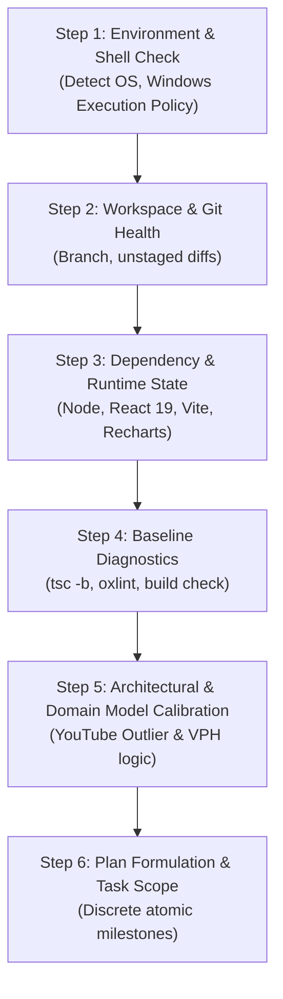

# AGENTS.md — Autonomous Agent Operating Manual & Session Initialization

Welcome to the **vidIQ Most Viewed & Outlier Analytics Dashboard** codebase. This document is the primary operational contract and onboarding protocol for any autonomous Agentic AI session (e.g., Antigravity, Claude Code, Cursor Composer, Windsurf Cascade, Devin, or custom LLM pair programmers).

Any autonomous agent starting work in this repository **must execute the Session Initialization Sequence** before editing, adding, or refactoring code.

---

## 🚀 Phase 1: The Session Initialization Protocol (Step-by-Step)

When an agentic session begins, run this 6-step initialization sequence to calibrate environment context, discover existing baseline issues, and prevent regressions.



### Step 1: Environment & Shell Verification
* **Operating System**: Windows (NT).
* **Shell**: PowerShell / Windows Terminal.
* **CRITICAL TRAP — Execution Policy**: PowerShell blocks unsigned scripts (`npm.ps1 cannot be loaded because running scripts is disabled on this system`).
  * ❌ **DO NOT run**: `npm run build` or `npm run dev` directly in naked PowerShell if scripts are restricted.
  * ✅ **ALWAYS run**: `cmd /c npm run <script>` or `cmd /c npx <command>`.

### Step 2: Workspace & Git Health Check
Verify git working directory status before starting work:
```powershell
git status
git diff --stat
```
* Note any unstaged files or active working branch.
* Ensure `.gitignore` covers build artifacts (`dist`, `node_modules`, `*.log`).

### Step 3: Dependency & Toolchain Audit
Verify that packages are installed and aligned with `package.json`:
* Core libraries: `react` (^19.3.1), `react-dom` (^19.3.1), `lucide-react` (^1.66.0), `recharts` (^3.10.1).
* Build tool: `vite` (^8.3.5), `@vitejs/plugin-react` (^6.1.2).
* Linter: `oxlint` (^1.89.0).
* TypeScript: `typescript` (~7.0.2).

### Step 4: Baseline Diagnostic Run
Establish the existing state of the codebase before writing code.
1. Run linter:
   ```cmd
   cmd /c npm run lint
   ```
2. Run TypeScript check:
   ```cmd
   cmd /c npx tsc -b
   ```
3. Run Production Build:
   ```cmd
   cmd /c npm run build
   ```
*(Note: Codebase passes with 0 lint warnings and 0 type errors across all modules).*

### Step 5: Domain & Architectural Alignment
Read and understand the domain model:
* What does this app do? It is a **YouTube Outlier & Viral Video Analytics Dashboard** (vidIQ-style) targeting Bangla & global content creators.
* Key formulas: **VPH** (Views Per Hour) and **Outlier Score** (ratio of video views to channel average views).
* Dual-mode data flow: Embedded mock dataset + Live YouTube Data API v3 integration.

### Step 6: Plan Formulation & Blast-Radius Check
* Formulate clear, atomic hypotheses and steps.
* Always preserve user-facing features, especially Bangla language localization, mock data, and chart visualizations.

---

## 📊 Project Architecture & Deep-Dive Analysis

### 1. High-Level Overview
The application is a single-page web app built with React 19 and Vite 8, presenting a comprehensive analytics dashboard for discovering trending, breakout, and viral YouTube videos.

```
E:\Subroto\Video\
├── public/                 # Static assets (favicons, icons)
├── src/
│   ├── assets/             # Images and SVG assets (hero.png, vite.svg)
│   ├── App.css             # Starter template CSS styles
│   ├── App.tsx             # Main Monolith (~1,750 lines: state, logic, UI)
│   ├── index.css           # Global typography & root styles
│   └── main.tsx            # React root mount point (createRoot)
├── index.html              # HTML entry point
├── package.json            # Scripts & dependencies
├── tsconfig.json           # Composite TypeScript references
├── tsconfig.app.json       # Strict App TypeScript configuration
├── tsconfig.node.json      # Node/Vite config TypeScript rules
├── vite.config.ts          # Vite build configuration
└── _oxlintrc.json          # Oxlint configuration
```

### 2. Core Domain Metrics & Formulas

| Metric | Formula | Purpose |
| :--- | :--- | :--- |
| **VPH (Views Per Hour)** | $\frac{\text{Total Views}}{\max(1, \text{Hours Since Published})}$ | Identifies current velocity and trending momentum rather than lifetime view counts. |
| **Outlier Score** | $\frac{\text{Video Views}}{\max(1, \text{Channel Average Views})}$ | Highlights videos from small or mid-size channels that heavily outperform their baseline (e.g., $15\times$). |
| **Engagement Rate** | $\frac{\text{Likes} + \text{Comments}}{\max(1, \text{Views})} \times 100$ | Measures audience resonance and interaction density. |
| **Views Per Sub** | $\frac{\text{Views}}{\max(1, \text{Channel Subscribers})}$ | Measures reach beyond subscriber base. |

### 3. Data Pipelines: Dual-Mode Operation
1. **Mock Mode (Default)**:
   * Array of realistic Bangla & Global YouTube videos (`INITIAL_VIDEOS`) covering AI tutorials, tech reviews, cooking, travel, freelancing, and gaming.
   * Includes historical hourly VPH arrays (`vphHistory`) for Recharts visualizations.
2. **Live Mode (YouTube Data API v3)**:
   * Prompt modal for user's Google API Key.
   * 3-stage query chain:
     1. `GET /youtube/v3/search` with `order=viewCount`, `type=video`, and `publishedAfter` filters.
     2. `GET /youtube/v3/videos` with `part=snippet,statistics,contentDetails` for exact view/like/comment counts and ISO8601 duration.
     3. `GET /youtube/v3/channels` with `part=statistics` to extract subscriber counts and channel-level average views.

---

## 🏛️ Codebase Structure & Architecture Patterns

The codebase has been refactored into a clean, decoupled modular architecture:

### 1. Modular Directory Layout
```
src/
├── assets/                  # Static media assets
├── components/
│   ├── analytics/
│   │   ├── KpiStatsBar.tsx  # Top KPI stats cards
│   │   └── VphChart.tsx     # Recharts Area components
│   ├── layout/
│   │   ├── Navbar.tsx       # Brand, action buttons, API key trigger
│   │   └── FilterBar.tsx    # Topic chips, sliders, view toggles
│   ├── modals/
│   │   ├── ApiKeyModal.tsx  # YouTube Data API v3 configuration modal
│   │   ├── CodeModal.tsx    # Algorithm & backend formula guide modal
│   │   └── VideoDetailModal.tsx # Full video analysis & tag copy modal
│   └── video/
│       ├── VideoGrid.tsx    # Responsive grid display
│       ├── VideoTable.tsx   # Detailed tabular view
│       └── VideoCard.tsx    # Individual video card with metrics & badges
├── data/
│   └── mockVideos.ts        # INITIAL_VIDEOS, QUICK_TOPICS
├── services/
│   └── youtubeApi.ts        # YouTube Data API v3 query pipeline & channel mapper
├── types/
│   └── video.ts             # VideoItem, RawVideoItem, Filter types, KpiStats
├── utils/
│   ├── formatters.ts        # formatNumber, getRelativeTime, parseISO8601Duration
│   └── metrics.ts           # calculateMetrics (VPH, Outlier Score, Engagement)
├── App.tsx                  # Root orchestrator & context provider (~250 lines)
├── index.css                # Global stylesheet & Tailwind v4 directives
└── main.tsx                 # App mount
```

### 2. Strict Type Safety
* All data entities adhere to explicit TypeScript interfaces in [`src/types/video.ts`](file:///E:/Subroto/Video/src/types/video.ts).
* Zero `any`, zero implicit casts, and zero `never[]` state errors.
* `tsc -b` compiles cleanly without warnings or errors.

### 3. Tailwind CSS Integration
* Powered by `@tailwindcss/vite` and `tailwindcss` v4.
* `@import "tailwindcss";` in [`src/index.css`](file:///E:/Subroto/Video/src/index.css) ensures all utility classes render properly.

### 4. Windows Script Execution Policy
* Windows security policy blocks direct execution of PowerShell `.ps1` wrappers for npm.
* **Agent Guidance**: Always use `cmd /c npm ...` or `cmd /c npx ...` in all execution tools.

---

## 🛠️ Operational Rules of Engagement for Agents

### 1. Execution Protocol
* **Do not edit blind**: Inspect target line numbers and surrounding context before applying `edit_file`.
* **Atomic edits**: Keep edits targeted to the specific task request.
* **Non-destructive preservation**: Never remove Bangla translations, mock datasets, or functional chart configurations unless explicitly requested by the user.

### 2. Validation & Quality Gates
Every code change must be validated through these quality gates:

```cmd
:: 1. Oxlint Lint Check (Super fast linter)
cmd /c npm run lint

:: 2. TypeScript Compiler Check
cmd /c npx tsc -b

:: 3. Vite Production Build Verification
cmd /c npx vite build
```

---

## 📋 Recommended Refactoring Target Structure

If assigned to refactor or extend the codebase, follow this modular layout:

```
src/
├── assets/                  # Static media assets
├── components/
│   ├── analytics/
│   │   ├── KpiStatsBar.tsx  # Top KPI stats cards
│   │   └── VphChart.tsx     # Recharts Area & Bar components
│   ├── layout/
│   │   ├── Navbar.tsx       # Brand, action buttons, API key trigger
│   │   └── FilterBar.tsx    # Topic chips, sliders, view toggles
│   ├── modals/
│   │   ├── ApiKeyModal.tsx  # YouTube Data API v3 configuration modal
│   │   ├── CodeModal.tsx    # Algorithm & backend formula guide modal
│   │   └── VideoDetailModal.tsx # Full video analysis & tag copy modal
│   └── video/
│       ├── VideoGrid.tsx    # Responsive grid display
│       ├── VideoTable.tsx   # Detailed tabular view
│       └── VideoCard.tsx    # Individual video card with metrics & badges
├── services/
│   └── youtubeApi.ts        # YouTube Data API v3 query pipeline & channel mapper
├── types/
│   └── video.ts             # VideoItem, VphDataPoint, ChannelStats interfaces
├── utils/
│   ├── formatters.ts        # formatNumber, getRelativeTime, parseISO8601Duration
│   └── metrics.ts           # calculateMetrics (VPH, Outlier Score, Engagement)
├── App.tsx                  # Root orchestrator & context provider
├── index.css                # Global stylesheet & Tailwind directives
└── main.tsx                 # App mount
```

---

## 💡 Quick Reference: Common Task Recipes

### Launch Dev Server for Manual Verification
```cmd
cmd /c npm run dev
```

### Run Oxlint with Auto-Fix
```cmd
cmd /c npx oxlint --fix
```

### Clean Build Output
```powershell
if (Test-Path dist) { Remove-Item -Recurse -Force dist }
```
